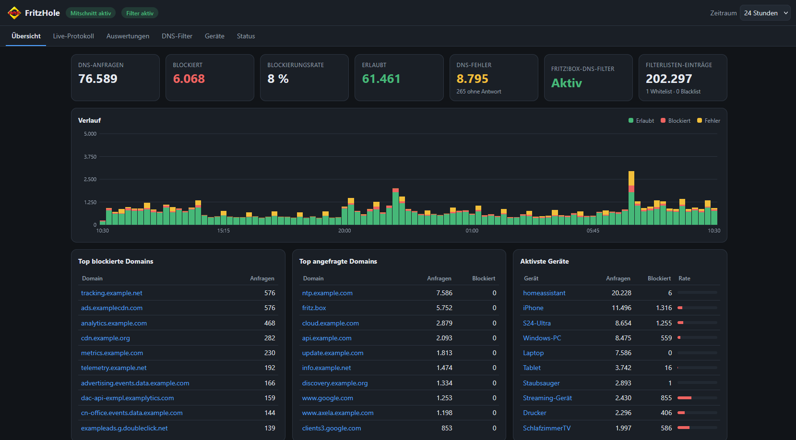

<b>Deutsch</b> | <a href="README.en.md">English</a>

  

<h1 align="center">FritzHole</h1>

  <b>DNS-Monitoring und Filterverwaltung für die FRITZ!Box – direkt in Home Assistant.</b> 
  Wie Pi-hole, nur ohne eigenen DNS-Server.

  
  
  
  
  

  

 Domains und Gerätenamen für den Screenshot anonymisiert.

> [!IMPORTANT]
> **Inoffizielles Open-Source-Projekt – nicht von AVM.** FritzHole wird privat entwickelt und steht in keiner
> Verbindung zur AVM GmbH bzw. FRITZ! GmbH. Bei Fragen und Problemen bitte **nicht den AVM-Support** kontaktieren,
> sondern die [Issues](https://github.com/Milinator/fritzhole-ha/issues) dieses Repositories nutzen.

---

## Was ist FritzHole?

Neuere FRITZ!OS-Versionen bringen einen **eingebauten DNS-Filter** mit: Werbe- und Tracking-Domains blockiert die
FRITZ!Box selbst, zum Beispiel über Blocklisten wie HaGeZi. Was dabei im Netz passiert, ist in der FRITZ!Box
allerdings kaum zu sehen.

**FritzHole macht das sichtbar und bedienbar.** Die App läuft in Home Assistant, liest die DNS-Anfragen im Heimnetz
live mit und zeigt in einem Dashboard, welche Geräte welche Domains anfragen und was blockiert wird. Ausnahmen,
Filterlisten und den Filter selbst verwaltest du direkt dort.

### Warum kein Pi-hole oder AdGuard Home?

Mit Pi-hole oder AdGuard Home betreibst du einen **zusätzlichen DNS-Server** und musst alle Geräte (bzw. den
DHCP-Server der FRITZ!Box) darauf umstellen. Fällt dieser Server aus, funktioniert im ganzen Netz keine
Namensauflösung mehr.

FritzHole geht einen anderen Weg:

- **Die FRITZ!Box bleibt der DNS-Server.** Nichts wird umgeleitet, kein Gerät muss umgestellt werden.
- **Gefiltert wird weiterhin von der FRITZ!Box selbst.** FritzHole beobachtet und verwaltet nur.
- **Läuft FritzHole nicht, merkt das Netz nichts davon.** Die Filterung arbeitet unabhängig weiter.

## Funktionen

**Monitoring**

- **Live-DNS-Protokoll** – jede DNS-Anfrage im Heimnetz in Echtzeit, mit Gerät, Domain, Typ, Antwort und Latenz
- **Erkennung blockierter Anfragen** – die FRITZ!Box beantwortet blockierte Domains mit `0.0.0.0` bzw. `::`;
  zusätzlich werden NXDOMAIN, Fehler und unbeantwortete Anfragen unterschieden
- **Statistiken und Verlauf** – Anfragen, Blockierungsrate und Fehler, Zeitverlauf als Diagramm,
  Zeiträume von 1 Stunde bis 30 Tage
- **Auswertungen** – meistgefragte und meistblockierte Domains, aktivste Geräte mit Blockierungsrate,
  Filter nach Zeitraum, Status, Gerät und Suchbegriff
- **Geräteerkennung** – Gerätenamen von der FRITZ!Box, IPv4- und IPv6-Adressen eines Geräts zusammengefasst
  (über die MAC-Adresse), eigene Namen und manuelles Zusammenführen möglich

**Verwaltung des FRITZ!Box-DNS-Filters**

- **Allowlist und Blocklist** – Ausnahmen anlegen, bearbeiten und löschen; direkt aus dem Live-Protokoll per
  Kontextmenü („Erlauben“ / „Sperren“), mit Anzeige, ob eine Domain bereits eingetragen ist
- **Filter ein- und ausschalten** – dauerhaft oder **befristet pausieren** (5, 15, 30, 60 Minuten oder eigene Dauer);
  die automatische Wiedereinschaltung funktioniert auch nach einem Neustart der App
- **Filterlisten verwalten** – Listen hinzufügen, bearbeiten, aktivieren/deaktivieren und löschen, mit
  Eintragszahl und Fehleranzeige pro Liste
- **Filterlisten aktualisieren** – manuell mit Fortschrittsanzeige oder automatisch in den Stufen der FRITZ!Box
  (alle 8 Stunden, täglich, wöchentlich, monatlich, nie)
- **Statistik der FRITZ!Box** – Anfrage- und Blockierzähler der Box selbst

**Home Assistant**

- Eigenes Dashboard in der **Seitenleiste** (Ingress) – kein offener Port, keine zusätzliche Anmeldung,
  standardmäßig nur für Administratoren sichtbar
- Einstellungen über die App-Konfiguration in Home Assistant (Deutsch/Englisch)
- Alle Daten bleiben lokal auf deinem Home-Assistant-System

> [!NOTE]
> FritzHole stellt derzeit **keine Home-Assistant-Entitäten** (Sensoren, Schalter) bereit. Bedient wird es über das
> Dashboard in der Seitenleiste.

## Kompatibilität und Voraussetzungen

| FRITZ!Box | FRITZ!OS | Live-Protokoll & Statistiken | DNS-Filter-Verwaltung | Status |
|---|---|:---:|:---:|---|
| 7530 AX | 8.40-136793 BETA (Laborversion) | ✅ | ✅ | **bestätigt** |
| andere Modelle | 8.50 oder neuer | ❔ | ❔ | ungetestet |
| beliebig | ohne integrierten DNS-Filter (vor 8.50) | ❔ | ❌ | ungetestet, DNS-Filter-Verwaltung nicht möglich |

**Warum so vorsichtig?** FritzHole nutzt Schnittstellen von FRITZ!OS, die **nicht offiziell dokumentiert** sind:
den Paketmitschnitt der FRITZ!Box-Oberfläche und eine **Beta-API** für den DNS-Filter. AVM kann beides mit jedem
Update ändern. Dass jede Firmware-Version funktioniert, lässt sich deshalb nicht zusagen.

> [!TIP]
> **Hilf mit, die Tabelle zu füllen!** Du hast FritzHole mit einem anderen Modell oder einer anderen FRITZ!OS-Version
> ausprobiert – erfolgreich oder nicht? Melde es über ein
> [Kompatibilitäts-Issue](https://github.com/Milinator/fritzhole-ha/issues/new?template=compatibility.md).

**Voraussetzungen**

- Home Assistant OS oder Supervised (amd64 oder aarch64)
- Ein FRITZ!Box-Benutzer mit dem Recht **„FRITZ!Box Einstellungen“** (nötig für Paketmitschnitt und DNS-Filter-API)
- Für die DNS-Filter-Verwaltung: FRITZ!OS mit integriertem DNS-Filter – eingeführt mit FRITZ!OS 8.50 bzw. den
  zugehörigen Laborversionen. Ohne ihn funktionieren Live-Protokoll und Statistiken weiterhin, der Tab
  „DNS-Filter“ zeigt dann eine Fehlermeldung.
- Optional für Gerätenamen: in der FRITZ!Box „Zugriff für Anwendungen zulassen“ (TR-064)

## Installation

### Mit einem Klick

Der Button öffnet dein Home Assistant und fügt das Repository hinzu. Voraussetzung ist, dass
[My Home Assistant](https://my.home-assistant.io/) die Adresse deiner Instanz kennt – beim ersten Klick wirst du
danach gefragt.

### Manuell

1. In Home Assistant **Einstellungen → Apps → App-Store** öffnen.
2. Oben rechts **⋮ → Repositories** wählen.
3. `https://github.com/Milinator/fritzhole-ha` eintragen und **Hinzufügen**.

### Danach

1. **FritzHole** im App-Store auswählen und **Installieren**. Die App wird lokal auf deinem System gebaut, der erste
   Build dauert einige Minuten.
2. Im Tab **Konfiguration** FRITZ!Box-Adresse, Benutzername und Passwort eintragen und speichern.
3. **Starten** und **„In Seitenleiste anzeigen“** aktivieren (empfohlen auch „Beim Start ausführen“).

> In älteren Home-Assistant-Versionen heißen die Menüpunkte noch „Add-ons“ und „Add-on-Store“.

## Erste Schritte

1. **FRITZ!Box-Benutzer anlegen:** am besten einen eigenen, z. B. `fritzhole` (System → FRITZ!Box-Benutzer), mit dem
   Recht „FRITZ!Box Einstellungen“.
2. **DNS-Filter in der FRITZ!Box einschalten** und mindestens eine Filterliste einrichten – sonst wird nichts
   blockiert, was FritzHole anzeigen könnte.
3. **FritzHole in der Seitenleiste öffnen.** Oben erscheint „Mitschnitt aktiv“, sobald die Verbindung steht.
4. **Tab „Live-Protokoll“:** über **⋯** (oder Rechtsklick) an einer Zeile eine Domain erlauben oder sperren.
5. **Tab „DNS-Filter“:** Allowlist/Blocklist, Pause, Filterlisten und automatische Aktualisierung.

Alle Optionen und eine Fehlersuche-Tabelle stehen in der [App-Dokumentation](fritzhole/DOCS.md).

## Bekannte Einschränkungen

- **Undokumentierte Schnittstellen:** Paketmitschnitt und DNS-Filter-API können sich mit FRITZ!OS-Updates ändern.
- **Nur das Heimnetz (LAN/WLAN):** Geräte im Gastnetz sowie Geräte mit **DNS-over-HTTPS/TLS** (z. B. Browser mit
  „sicherem DNS“) erscheinen nicht oder unvollständig.
- **Ein Mitschnitt zur gleichen Zeit:** Ein paralleler Mitschnitt in der FRITZ!Box-Oberfläche kann FritzHole stören
  und umgekehrt.
- **DNS über TCP** wird nur experimentell ausgewertet.
- **Speicherbedarf:** Jede DNS-Anfrage wird einzeln gespeichert (gemessen rund 340 Byte inklusive Indizes). In Netzen mit sehr vielen
  Anfragen wächst die Datenbank schnell – `retention_days` und `max_events` passend einstellen
  (siehe [DOCS.md](fritzhole/DOCS.md#speicherbedarf)).
- **Subdomains:** Ob ein Eintrag für `example.com` auch `sub.example.com` erfasst, entscheidet die FRITZ!Box.
  FritzHole markiert solche Fälle mit „≈“; das Verhalten ist nicht verifiziert.
- Bisher nur mit einem Modell und einer Laborversion getestet (siehe oben).

**Ideen – noch nicht umgesetzt:** Geräte oder Domains von der Protokollierung ausschließen; platzsparendere
Speicherung mit stündlichen Zusammenfassungen.

## Datenschutz und Sicherheit

**Was FritzHole ausliest**

- Über den Paketmitschnitt der FRITZ!Box **nur DNS-Verkehr** (UDP/TCP Port 53) der gewählten Schnittstelle:
  Zeitpunkt, IP- und MAC-Adresse des Geräts, angefragte Domain, Typ und Antwort. Anderen Datenverkehr schneidet die
  FRITZ!Box gar nicht erst mit.
- Optional die Geräteliste der FRITZ!Box (IP, MAC, Gerätename) über TR-064, alle 10 Minuten.
- Die Konfiguration des DNS-Filters: Ausnahmen, Filterlisten, Einstellungen und Zähler.

**Was lokal gespeichert wird**

- In einer SQLite-Datenbank unter `/data` der App: DNS-Ereignisse, Geräte (MAC, Namen, IP-Adressen) und der Zustand
  einer laufenden Pause.
- Ereignisse werden nach `retention_days` (Standard 14 Tage) bzw. beim Erreichen von `max_events` automatisch gelöscht.
- Das FRITZ!Box-Passwort verwaltet Home Assistant in der App-Konfiguration; FritzHole schreibt es nirgends hin.
  Passwort und Session-IDs erscheinen weder in Logs noch in Antworten der App.
- `/data` ist Teil der Home-Assistant-Sicherungen – das DNS-Protokoll steckt also auch in deinen Backups.

**Was FritzHole an der FRITZ!Box ändern kann**

FritzHole ist **kein reines Anzeigewerkzeug**. Über das Dashboard lassen sich ändern:

- Ausnahmen (Allowlist/Blocklist) anlegen, ändern und löschen
- den DNS-Filter ein- und ausschalten oder pausieren
- Filterlisten anlegen, ändern, aktivieren/deaktivieren, löschen und aktualisieren
- das Intervall der automatischen Filterlisten-Aktualisierung

Jede Änderung muss im Dashboard bestätigt werden und wird anschließend durch erneutes Auslesen geprüft. Wer nur
beobachten möchte, setzt die Option **`dnsfilter_management: false`** – dann ist der DNS-Filter-Bereich
schreibgeschützt. Außerdem startet und beendet FritzHole den **Paketmitschnitt** der FRITZ!Box. Andere Einstellungen
der Box verändert es nicht.

**Was das Ausschalten des DNS-Filters bewirkt**

Der DNS-Filter wirkt für **alle Geräte**, die die FRITZ!Box als DNS-Server nutzen. Ausschalten oder Pausieren hebt
die Filterung also für das **gesamte Netz** auf. Eine Pause schaltet den Filter zum gewählten Zeitpunkt automatisch
wieder ein, „Dauerhaft ausschalten“ nicht.

**Zugriff und Netzwerk**

- Das Dashboard ist nur über Home Assistant (Ingress) erreichbar und standardmäßig nur für Administratoren sichtbar.
- FritzHole sendet **keine Daten an externe Dienste**.
- Die Verbindung zur FRITZ!Box läuft im Heimnetz per HTTP. Das Passwort wird dabei nicht im Klartext übertragen
  (Challenge-Response bzw. HTTP-Digest), die Session-ID schon.

**Personenbezug:** DNS-Protokolle zeigen, welche Dienste ein Gerät nutzt. Sobald sich ein Gerät einer Person zuordnen
lässt, sind das personenbezogene Daten. Informiere andere Personen in deinem Haushalt, halte die Aufbewahrung kurz und
protokolliere keine Geräte, deren Daten dir nicht zustehen (z. B. Dienstrechner). Dies ist keine Rechtsberatung.

## Feedback und Mitwirkung

- **Fehler gefunden?** → [Bug melden](https://github.com/Milinator/fritzhole-ha/issues/new?template=bug_report.md)
- **Anderes FRITZ!Box-Modell getestet?** →
  [Kompatibilität melden](https://github.com/Milinator/fritzhole-ha/issues/new?template=compatibility.md)
- **Ideen oder Fragen?** → [Issues](https://github.com/Milinator/fritzhole-ha/issues)
- **Code beitragen?** → Aufbau, Tests und lokaler Start sind in [docs/development.md](docs/development.md) beschrieben.

Bitte in Issues **keine Passwörter, Session-IDs oder vollständigen DNS-Protokolle** posten.

## Weiterführende Dokumentation

| Dokument | Inhalt |
|---|---|
| [fritzhole/DOCS.md](fritzhole/DOCS.md) | App-Dokumentation: Optionen, Funktionsweise, Fehlersuche (auch in Home Assistant sichtbar) |
| [fritzhole/CHANGELOG.md](fritzhole/CHANGELOG.md) | Änderungen pro Version |
| [docs/architecture.md](docs/architecture.md) | Aufbau der App und Datenfluss |
| [docs/fritzbox-interfaces.md](docs/fritzbox-interfaces.md) | Technische Details der Kommunikation mit der FRITZ!Box |
| [docs/api.md](docs/api.md) | HTTP-API des Dashboards |
| [docs/development.md](docs/development.md) | Entwicklung, Tests, lokaler Start, Releases |

Die technischen Dokumente unter `docs/` sind derzeit nur auf Deutsch verfügbar.

## Lizenz und Disclaimer

FritzHole steht unter der [MIT-Lizenz](LICENSE) und wird **ohne jede Gewährleistung** bereitgestellt. Die Nutzung –
insbesondere das Ändern von FRITZ!Box-Einstellungen – erfolgt auf eigenes Risiko.

FritzHole ist ein unabhängiges Open-Source-Projekt. Es besteht keine Verbindung zur AVM GmbH bzw. FRITZ! GmbH; das
Projekt wird von ihr weder unterstützt noch geprüft oder freigegeben. FRITZ!, FRITZ!Box und FRITZ!OS sind Marken der
AVM GmbH bzw. FRITZ! GmbH. Sie werden hier ausschließlich genannt, um zu beschreiben, mit welchen Geräten FritzHole
zusammenarbeitet. Daraus ergibt sich keine Erlaubnis zur Nutzung dieser Marken oder Logos.
